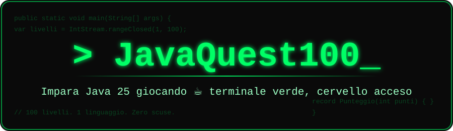

<div align="center">



<br>


### **100 livelli. 1 linguaggio. Zero scuse.** ☕⚡

JavaQuest100 è un gioco-corso per Windows: ogni livello ti spiega un argomento di Java,<br>
ti sfida a **rimettere in ordine le righe di codice** come un puzzle e ti interroga con un mini-quiz.<br>
Sbagli? Perdi punti (e un pezzo di dignità). Indovini? Punti, gloria e un bel verde brillante. 😎

<br>

[**⬇️ SCARICA IL GIOCO**](../../releases/latest) &nbsp;·&nbsp; [🎮 Come si gioca](#-come-si-gioca) &nbsp;·&nbsp; [🗺️ Il programma](#️-il-programma-10-categorie--10-fasi) &nbsp;·&nbsp; [🛠️ Compilalo](#️-compilarlo-da-soli)

</div>

---

## 🎮 Come si gioca

Ogni livello è un piccolo viaggio in 4 tappe:

| | Tappa | Cosa succede |
|:-:|---|---|
| 📖 | **Lezione** | Leggi la spiegazione e guarda il codice d'esempio. Il colore del codice cambia in base alla categoria, perché la vita è già troppo grigia. |
| 🧩 | **Esercizio** | Clicca i frammenti di codice per comporre il programma giusto. Attenzione ai *distrattori*, righe dall'aria innocente che sono lì solo per fregarti. 🕵️ |
| ❓ | **Mini-quiz** | 3 domande a risposta multipla e si passa al livello successivo. |
| 🏁 | **Fine gioco** | Il gioco genera da solo un **PDF** con le risposte giuste e sbagliate. Puoi scaricarlo e appenderlo in camera (o nasconderlo, scegli tu). |

### 🏆 Punteggio

| Azione | Punti |
|---|:-:|
| Esercizio indovinato | **+10** 🎉 |
| Tentativo sbagliato | **-5** 💥 |
| Domanda del quiz giusta | **+5** |
| Domanda del quiz sbagliata | **-2** |

> 🎲 **Tutto è casuale!** Ogni volta che apri il gioco, l'ordine dei livelli, dei frammenti e delle risposte si rimescola. Nessun trucco da memorizzare.

> 🆘 **Bloccato?** Ogni schermata ha il pulsante **AIUTO** con un suggerimento. Non ti giudichiamo. Troppo. 🙈

> 📚 **Allenamento mirato:** nel menu **Elenco** trovi tutte le 100 domande divise per categoria, per allenarti dove fa più male.

---

## 🗺️ Il programma: 10 categorie × 10 fasi

| # | Categoria | Fasi |
|:-:|---|:-:|
| 1 | 🧱 Fondamenti | 1-10 |
| 2 | 🔀 Controllo del flusso | 11-20 |
| 3 | 🔤 Metodi, Array e Stringhe | 21-30 |
| 4 | 🧬 Programmazione a oggetti | 31-40 |
| 5 | 📐 Interfacce, Record, Enum, Sealed | 41-50 |
| 6 | 📦 Generics e Collections | 51-60 |
| 7 | 🌊 Lambda e Stream | 61-70 |
| 8 | 💾 Eccezioni, I/O, NIO | 71-80 |
| 9 | 🧵 Concorrenza (Virtual Threads inclusi) | 81-90 |
| 10 | 🚀 Java moderno 21-25 e strumenti | 91-100 |

Il piano completo con tutte le 100 fasi è in [`data-src/outline.md`](data-src/outline.md).

---

## 💾 Scarica e gioca

Vai nella sezione **[Releases](../../releases)** e scarica `JavaQuest100_singolo.exe`. Fine: niente installer, niente Java da installare, il runtime è già dentro.

- ✅ Funziona su **Windows 64 bit**.
- 📂 Al primo avvio si estrae in `%LOCALAPPDATA%\JavaQuest100_app` (~150 MB), poi parte in un lampo.
- ⚠️ L'exe non è firmato digitalmente: SmartScreen o l'antivirus potrebbero fare i diffidenti. Clicca *Maggiori informazioni → Esegui comunque*.

---

## 🛠️ Compilarlo da soli

Il repository non contiene il JDK né JavaFX (sono pesanti). Per compilare:

1. Scarica **JDK 25** (es. Temurin) e mettilo in `tools/jdk`.
2. Scarica **JavaFX 25** SDK e jmods per Windows (gluonhq.com) in `tools/javafx-sdk` e `tools/javafx-jmods`.
3. Lancia:

```powershell
powershell -ExecutionPolicy Bypass -File build.ps1 -Test            # crea dist\JavaQuest100\JavaQuest100.exe
powershell -ExecutionPolicy Bypass -File build-singolo.ps1          # crea exe-unico\JavaQuest100_singolo.exe
```

Altri comandi utili: `run.ps1` (avvio in sviluppo), `python data-src/merge.py` (unisce i contenuti `part*.json` nel curriculum).

---

## 🧱 Sotto il cofano

- ☕ Java 25 + JavaFX, **nessuna libreria esterna**: parser JSON, evidenziatore di sintassi e generatore PDF sono scritti a mano.
- 🎨 Tema nero e verde in stile terminale, tutto nel CSS ([`style.css`](src/main/resources/css/style.css)).
- 📦 Runtime ridotto con `jlink`, pacchetto con `jpackage`, file unico autoestraente.

<div align="center">

<br>

**Buon divertimento e che il `NullPointerException` sia con te.** 🚀

</div>
